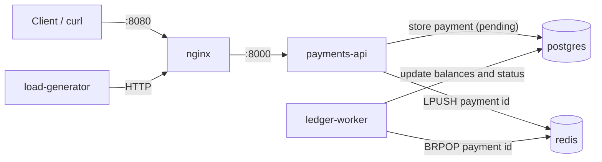

# FinSim

[](https://codespaces.new/bohdanmatveiev15/devops-sim)

FinSim is a learning homelab project: a small payment system for a fictional fintech
company, used to practise DevOps work on a realistic application. FinSim is not a real
brand or product, and all data in it is test data.

The repository contains the application as developers would hand it over, plus `sim`, an
internal CLI for tracking work time.

## Architecture



| Service          | Purpose                                                       |
| ---------------- | ------------------------------------------------------------- |
| `payments-api`   | FastAPI service that accepts payments and reads their state   |
| `ledger-worker`  | Moves money between accounts and completes or rejects payments |
| `postgres`       | Stores accounts and payments, seeded with 10 test accounts    |
| `redis`          | Queue of payment ids waiting for processing                   |
| `nginx`          | Reverse proxy from host port 8080 to `payments-api`           |
| `load-generator` | Sends random requests so the system has live traffic          |

## Run

### GitHub Codespaces

This is the primary environment, and it needs only a browser. Select the **Open in GitHub
Codespaces** badge above. When the codespace is ready, `.env` already exists and `bin` is in
your `PATH`, so run:

```bash
make up
make ps
```

See [docs/codespaces.md](docs/codespaces.md) for stopping, rebuilding, opening ports and saving
quota.

### WSL2 Ubuntu

You need Docker Engine with the Compose plugin, and `make`.

```bash
cp .env.example .env
make up
make ps
```

### Commands

| Command               | Action                                                |
| --------------------- | ----------------------------------------------------- |
| `make up`             | Build and start all services                          |
| `make down`           | Stop and remove the containers                        |
| `make restart`        | Run `down`, then `up`                                 |
| `make ps`             | Show the service state                                |
| `make logs`           | Follow the logs of all services                       |
| `make logs s=nginx`   | Follow the logs of one service                        |
| `make load-on`        | Turn the load generator on                            |
| `make load-off`       | Turn the load generator off                           |
| `make reset`          | Delete all data and start again (asks for y/N)        |
| `make prune`          | Delete unused images and build cache, keep volumes (asks for y/N) |

The load generator reads `ENABLED` and `RPS` (requests per second) from `.env`. After you
change `RPS`, run `make up` to apply it.

## API examples

```bash
curl http://localhost:8080/health

curl -X POST http://localhost:8080/payments \
  -H 'Content-Type: application/json' \
  -d '{"from_account": 1, "to_account": 2, "amount": 25.50, "currency": "USD"}'

curl http://localhost:8080/payments/1

curl http://localhost:8080/accounts/1/balance
```

A payment starts as `pending`. The worker then sets it to `completed`, or to `rejected`
if the sender has too little money or the currency does not match both accounts. All test
accounts use USD.

## sim

In Codespaces, `sim` is ready to use. In WSL, run this from the repository root to add `bin`
to your `PATH`:

```bash
echo "export PATH=\"$PWD/bin:\$PATH\"" >> ~/.bashrc
source ~/.bashrc
```

| Command               | Action                                                |
| --------------------- | ----------------------------------------------------- |
| `sim init`            | Set the simulation start date                         |
| `sim start`           | Start a work session                                  |
| `sim stop ["note"]`   | Stop the session and save it to the worklog           |
| `sim pause`           | Pause the session; paused time is not counted         |
| `sim resume`          | Resume a paused session                               |
| `sim status`          | Show the session state and minutes worked today       |
| `sim focus [minutes]` | Run a focus timer, 50 minutes by default              |
| `sim dayoff [date]`   | Mark a day off, today by default (`YYYY-MM-DD`)       |
| `sim report [period]` | Show hours for `today` (default) or `week`            |
| `sim standup`         | Print a standup block ready to paste into chat        |
| `sim help`            | Show a short description of all commands              |

Exit codes: `0` success, `1` wrong usage, `2` state error.

Data is stored outside the repository in `$SIM_HOME`: `/workspaces/.devops-sim` in Codespaces,
and `~/.devops-sim/` by default in WSL. Run `sim standup` from inside
this repository, because it reads the commits and tickets of the current repository. Each
run moves the "last standup" marker, so a second run lists only newer commits.

A simulation day is a working day (Monday to Friday) counted from the `sim init` date,
without days marked with `sim dayoff`. One sprint is five such days.

## Repository layout

| Path               | Content                     |
| ------------------ | --------------------------- |
| `tickets/`         | Work tickets and their format |
| `docs/STATE.md`    | Current state of the project |
| `docs/runbooks/`   | Operational runbooks        |
| `docs/postmortems/`| Incident reviews            |
| `docs/adr/`        | Architecture decision records |
| `brag/`            | Achievements in STAR format |
