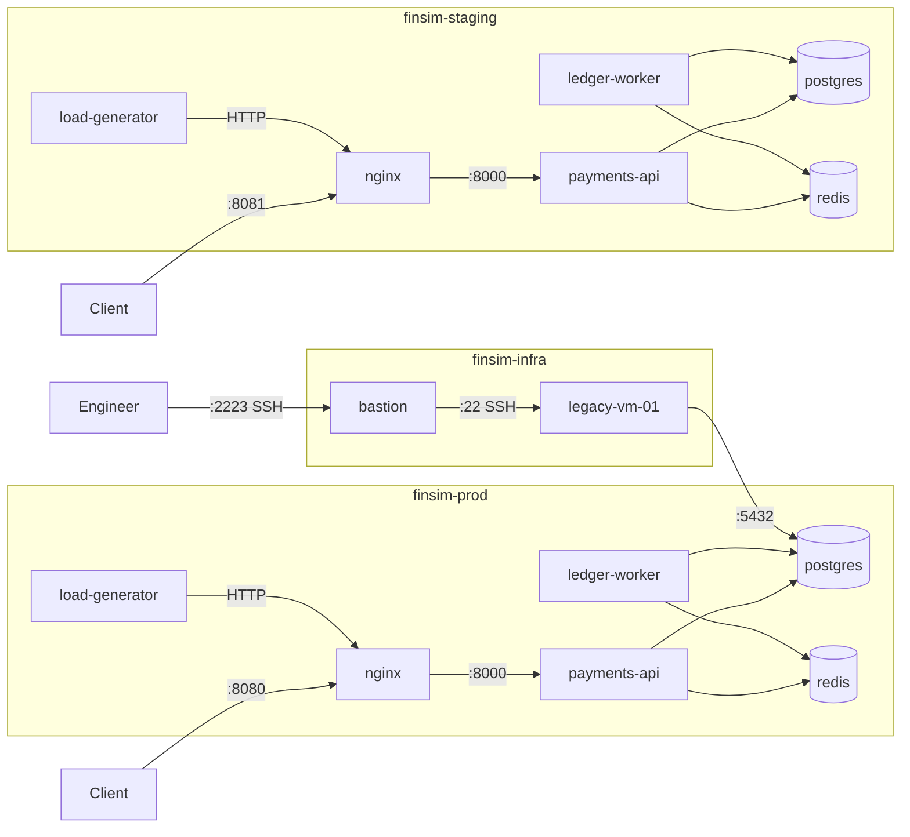

# FinSim architecture

FinSim runs as three Docker Compose projects on one machine.

| Project          | Purpose                          | Default state |
| ---------------- | -------------------------------- | ------------- |
| `finsim-prod`    | Production application           | Started with `make up` |
| `finsim-staging` | Pre-production copy of prod      | Off; `make up env=staging` |
| `finsim-infra`   | `bastion` and `legacy-vm-01`     | Started with `make infra-up` |

Prod and staging are built from the same code. Each one has its own env file, network and
database volume.

## Ports

| Port | Bound to         | Service                  | Reached from          |
| ---- | ---------------- | ------------------------ | --------------------- |
| 8080 | all interfaces   | prod `nginx`             | Host, Codespaces Ports tab |
| 8081 | all interfaces   | staging `nginx`          | Host, Codespaces Ports tab |
| 2223 | `127.0.0.1`      | `bastion` SSH            | Host only             |
| 22   | container only   | `legacy-vm-01` SSH       | `bastion` only        |
| 5432 | container only   | `postgres`               | Its own project, and prod also from `legacy-vm-01` |
| 6379 | container only   | `redis`                  | Its own project       |
| 8000 | container only   | `payments-api`           | Its own project       |
| 9100 | container only   | `ledger-worker` metrics  | Its own project       |

Port 2222 is not used because the Codespaces SSH server already listens on it.

## Who talks to whom

- `nginx` proxies all requests to `payments-api`.
- `payments-api` stores a payment in `postgres` and pushes its id to `redis`.
- `ledger-worker` takes payment ids from `redis` and updates `postgres`.
- `load-generator` sends traffic through `nginx`.
- `legacy-vm-01` is on the prod network and reads the prod database.
- `payments-api` serves `/metrics` on port 8000, and `ledger-worker` on port 9100.
